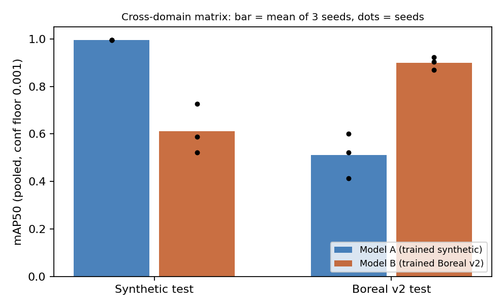
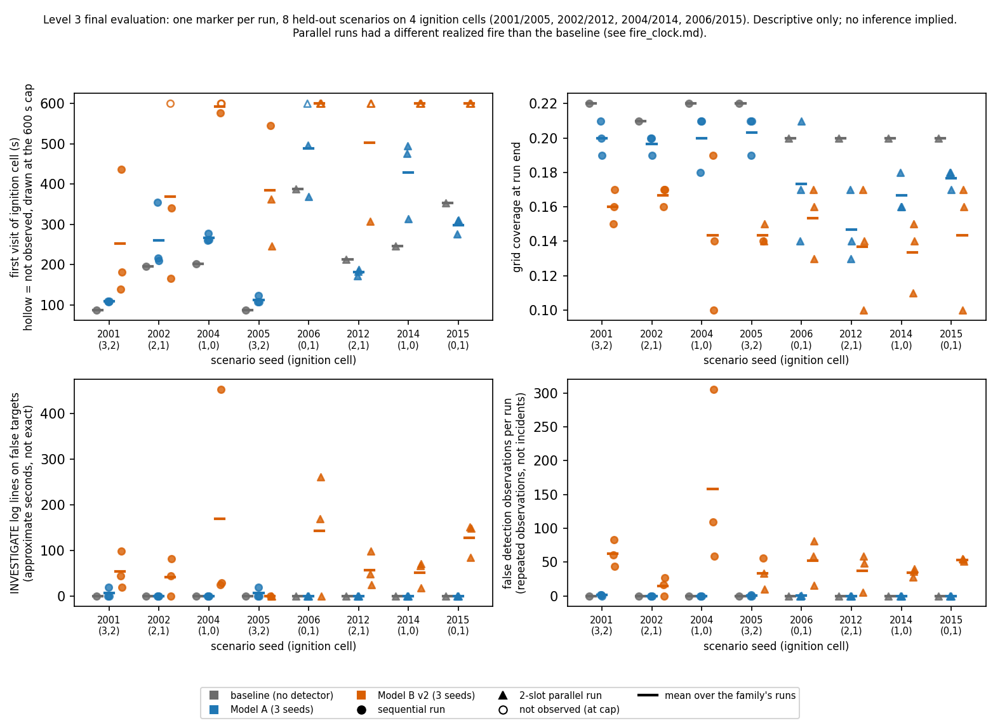
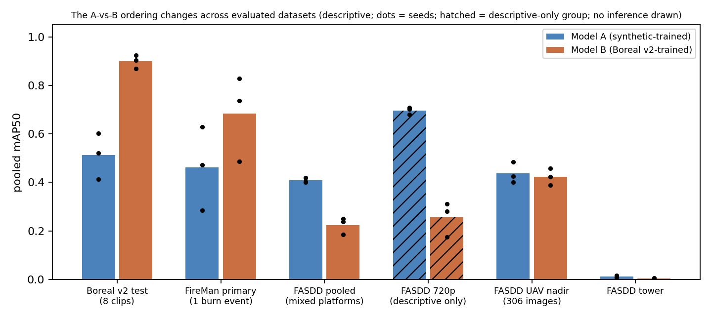

# Synthetic versus real training imagery for wildfire-smoke perception, and its effect on a simulated UAV monitor

ECE 496, Fall 2026. **Status: draft v1 (2026-11-11), written after the final Codex audit (verdict REVISE, claims narrowed here).** Every number below is taken from a recorded artifact in this repository; paths are given so a reader can check them. Nothing here is a preregistered result.

## Abstract

We ask whether training a smoke detector on auto-generated synthetic imagery instead of real aerial imagery changes (i) its measured perception, (ii) its cross-domain behaviour, and (iii) what a simulated UAV does when the detector drives a simple reactive search policy in ArduPilot SITL. We built a 2.5D synthetic image generator (a ground-plane texture seen through the same pinhole camera model that the UAV simulation uses), trained three seeds of YOLOv8s on a frozen synthetic set (Model A) and three on the clip-disjoint Boreal Forest Fire split (Model B), and evaluated all of them through one metric code path on synthetic, Boreal, FireMan and FASDD_UAV test imagery. **The defensible finding is that the ranking of the synthetic-trained and real-trained models varies across the evaluated datasets**: Model B is higher on the Boreal v2 test (pooled mAP50 0.899 vs 0.512) and on one FireMan burn event (0.683 vs 0.462), while Model A is higher on a pooled FASDD smoke-positive set (0.408 vs 0.224), a result carried by a 720p group of unknown platform that is reported descriptively only; on the FASDD UAV-nadir subset the pooled means are close (0.437 vs 0.423). Why the ranking changes (platform mix, annotation style, an edge-touch bias in the synthetic data, source-scene differences) is a hypothesis we did not test. In 56 SITL runs, the Model A and Model B arms behave differently under the implemented reactive investigation policy, in the same direction in all four ignition cells, and neither beat the no-detector patrol at reaching the ignition cell on average; these runs do not isolate a training-domain effect, test a probabilistic planner, or show improved autonomous monitoring. External validation is provisional until the owner-only annotation and overlap reviews are done.

## 1. Research question and structure

**Question.** Does the training domain (synthetic or real imagery) change how well a network perceives wildfire smoke, and does any difference propagate into autonomous UAV monitoring? Three levels: (1) domain comparison, (2) the 2x2 cross-domain matrix evaluated by one code path, (3) closed-loop UAV behaviour. Completed technical work is in sections 2-7; section 8 lists limitations and section 9 conclusions and future work. What was **not** done is stated in section 8 and not hidden in the results.

## 2. System architecture

| part | what it is | where |
|---|---|---|
| Fire truth | 2D cellular automaton over the coverage grid; owned by the ground station ("fog"); agents never run their own | `wildfire_sim.py`, `fog_tracker.py`, `fog/` |
| UAV | ArduCopter SITL, grid-frontier coverage mission, one UAV in the final Level 3 runs | `swarm_agent.py`, `mission/` |
| Camera | pinhole footprint to ground cells, **the same projection the generator uses** | `sim/camera.py` |
| Perception | YOLO detector wrapper, frame synthesis from the simulated fire, detections to MAVLink-side messages | `perception/`, `sim/frame_synth.py` |
| Planner | **reactive investigate-first policy** (`max(confidence)` per-cell evidence, 20 s lifetime, repeat bonus, 60 s per-cell cooldown) | `planning/priority.py` |
| Scoring | each detection is scored against fog truth at ingest (a burning cell within one cell counts as true) | `fog/state.py` |
| Dashboard | read-only stdlib HTTP viewer | `dashboard/` |

The intended chain, camera to network to detection probability to geographic probability map to priority region to coverage decision, was implemented **except the probability map** (`mapping/probability_map.py` is an empty stub). The planner that was flown is the placeholder `max(conf)` rule. Hence Level 3 measures a reactive policy, not probabilistic planning.

## 3. Synthetic data generation

`synth_smoke_v1` (frozen at commit `9cb0f1a`, tag `synth-v1`; record `docs/datasets/synth_smoke_v1.md`, spec `docs/synthetic/synth_smoke_v1_spec.md`): 5,304 images of 1280x720 (train 3,479, val 774, test 1,051 of which 350 are smoke-free), one class `smoke`, automatic boxes. Images are **2.5D**: a forest ground-plane texture rendered through a pinhole camera at a sampled position, altitude and angle, with smoke billboards placed at ground coordinates under the same projection, plus lighting, haze and colour randomisation. Smoke is a flat billboard, not a volume, with no real 3D occlusion. Known mismatch kept as a stated limitation: boxes touching the image border are 0.76 of synthetic boxes against about 0.30 of Boreal boxes (the owner cleared baseline training with this reported, `docs/project-status.md`). Synthetic test scenes share 6 texture slots, so frames are not independent scenes.

## 4. YOLO training

YOLOv8s (Ultralytics) initialised from COCO weights, 100 epochs, image size 640, batch 32, AdamW (lr0 0.002), deterministic mode, one class; Model A reuses Model B's recipe with the differences pinned in the spec; seeds 0, 1, 2 for each family (`models/MODELS.md`, `docs/experiments/level2_v2.md`, `docs/experiments/boreal_v2_results.md`). The Boreal v2 runs used `cache=ram`, a documented speed-only deviation. Checkpoints are hash-pinned in `models/MODELS.md` and `docs/baseline/baseline_v1.json` and are not in git. Model B in Levels 2 (v2) and 3 and in the external tests is the **Boreal v2** family (`real_boreal_v2_best_seed{0,1,2}`), not the older `real_boreal_best_v1`. Training reproduction on a fresh pod was checked only for the first epochs of one run; full-run bit-reproducibility is not shown.

## 5. Cross-domain evaluation (Level 2)

One harness (`eval/run_matrix.py` -> `eval/metrics.py`), frozen splits, conf floor 0.001, IoU 0.5, operating point 0.25. The first Boreal split (v1) was found not video-disjoint (3 clips shared between train and test); a clip-disjoint v2 split was built and all of Model B retrained (`docs/experiments/level2_v2_audit.md`, `boreal_v2.md`). Boreal v2 test has 8 source clips and effectively no negatives.

| train -> test | mAP50 mean (SD, n=3) | mAP50-95 | recall@0.25 | FP/img@0.25 |
|---|---|---|---|---|
| Synth -> Synth | 0.995 (0.000) | 0.986 | 1.000 | 0.000 |
| Synth -> Real (Boreal v2) | 0.512 (0.095) | 0.238 | 0.530 | 0.319 |
| Real (v2) -> Synth | 0.612 (0.104) | 0.289 | 0.496 | 0.072 |
| Real (v2) -> Real (Boreal v2) | 0.899 (0.027) | 0.531 | 0.899 | 0.129 |

Source: `docs/experiments/boreal_v2/results/level2/seed_aggregation.md`; figure: `figures/fig1_level2_matrix.png`. The Synth -> Synth cell is saturated and cannot discriminate. SD is across seeds; a clip-clustered bootstrap over the 8 test clips is test-set sampling only and is wide (Real -> Real seed 0: 0.923, [0.838, 0.966]; Synth -> Real seed 0: 0.602, [0.175, 0.810]), so the size of the gap is not tightly estimated although every seed shows the same ordering. Synthetic-trained models also fire on a share of real empty scenes (a train-split diagnostic), so synthetic negatives alone overstate specificity.

## 6. Level 3: UAV experiments in ArduPilot SITL

**Design.** 8 held-out scenarios on **4 distinct ignition cells** x 7 arms (no-detector patrol; Model A seeds 0-2; Model B-v2 seeds 0-2) = 56 runs, 600 s each, single UAV, oracle hazards off, plus 2 repeats. The ignition cell is the primary cluster (n = 4); scenarios are partly pseudo-replicates. Per-arm detector thresholds were set on separate calibration scenarios (A 0.30-0.45; B 0.01-0.02, two B thresholds at the practical floor); the criterion is a bespoke F0.5-style rule, not a calibrated probability. Full account: `docs/experiments/level3_final.md`.

**Observed behaviour under this reactive policy** (descriptive, capped at 600 s):

| quantity | patrol (no detector) | Model A | Model B-v2 |
|---|---|---|---|
| first true detection (s, capped mean) | none | 177 | 297 |
| ignition-cell first visit | earliest | later than patrol in 4/4 cells | later than patrol in 4/4 cells and 8/8 scenarios |
| ignition-cell visit not observed by 600 s | 0 of 8 | 1 of 24 | 14 of 24 |
| coverage fraction at 600 s | 0.209 | 0.183 | 0.148 |
| false detection observations per run | 0 | 0.3 | 55.7 |

A reached first detection and the ignition cell sooner than B and had far fewer false observations, in the same direction in 4 of 4 cells and 8 of 8 scenarios. Neither family beat the patrol on average at reaching the ignition cell. False counts are repeated observations, not independent incidents.

**What this does not show.** (a) *No unbiased causal training-domain effect*: A is evaluated in-domain on synthetic imagery and B cross-domain, thresholds differ per arm, 32 of 58 runs were run two at a time (30 main runs and the 2 repeats) in a parallel harness (the A0 repeat on an unrecoverable intermediate harness state), and fog schedules fire steps by wall clock, so the realized fire trajectory differs across arms (fire-time ratios 1.003-1.004 sequential, up to 1.09 parallel); A-vs-patrol direction differs between execution eras. (b) *No benefit of probabilistic planning*: no probability map was built. (c) *No improved autonomous monitoring*: a detection at the threshold floor diverts the UAV exactly as a confident one, and investigations preempt coverage, so the policy itself can cost coverage. (d) *No significance*: four clusters give a smallest possible exact two-sided sign-flip p of 0.125; capped times are lower bounds (15 of 56 ignition-cell visits censored); intervals that exclude zero are descriptive. (e) Radius-one truth matching, observed-only censoring bias and INVESTIGATE log lines as an approximate time proxy are documented in section 7a of the experiment report.

## 7. External validation

External sets were used only as tests (nobody trains on them), by the same harness and metric path, at conf 0.25 / IoU 0.5, batch 1, on the six frozen checkpoints. `eval/datasets_external.yaml` was **not frozen or preregistered** (see its `protocol_record`); results are exploratory.

| dataset | what | A pooled mAP50 | B pooled mAP50 | reading |
|---|---|---|---|---|
| Boreal v2 test (reference) | 8 clips, 4 sites, 2022 | 0.512 | 0.899 | descriptive |
| FireMan primary | 5 videos of one 2023-08-26 burn, 750 frames, loose/interpolated boxes | 0.462 | 0.683 | descriptive; one burn event, about 23 effective frames, seed SD about 0.17 |
| FASDD pooled | 2,149 smoke-positive images, mixed platforms | 0.408 | 0.224 | descriptive; 52.3% is the 720p group |
| FASDD 720p (1,125 imgs) | platform unknown | 0.697 | 0.256 | **descriptive only** |
| FASDD UAV nadir (306) | 1080p | 0.437 | 0.423 | pooled means differ by -0.014; equivalence not tested |
| FASDD tower (718) | fixed cameras | 0.011 | 0.003 | uninformative |
| FASDD excluding 720p (1,024) | | 0.176 | 0.189 | pooled +0.012; cluster-macro -0.033 (estimand-dependent) |

**Statistics, stated precisely.** Headline values are *pooled AP*, mean over seeds. A separate estimand, *cluster-macro AP* (AP inside each dHash64 scene group, averaged over groups), gives 0.523 vs 0.282 (B - A = -0.241) on all of FASDD at radius 6; it is a different number, not an interval for the pooled -0.184, and no interval is computed for pooled AP. The dHash groups are similarity components, not demonstrated independent videos, cameras or burn events, so bootstrap intervals and sign-flip p-values are **conditional sensitivity analyses** under that assumption and are not population-level inference. The descriptive-only 720p group (and any subset containing it) gets point values only. Monte Carlo p-values are reported with their floor 1/(n_mc+1) = 5.0e-06 and are never zero. Full tables: `docs/external_eval/fasdd_smoke_positive_v1_report.md`, `fireman_primary_v1_report.md`; findings: `*_findings.md`.

**Owner-only review still open (external status stays provisional):** G2 independent annotation review and G3 human overlap check; the 720p platform question (section 10).

## 8. Limitations

- Synthetic data is 2.5D (flat billboards, flat ground, one camera model); edge-touch rate differs from Boreal (0.76 vs 0.30); synthetic test scenes share 6 texture slots; synthetic negatives overstate specificity.
- Boreal has 31 source clips (test 8 clips); same-site and same-session relationships remain after the clip-disjoint v2 split; automated overlap checks against external sets are weaker than proving no shared source event.
- Three seeds per family; seed SD is large for cross-domain cells. Bootstrap intervals are test-set sampling only.
- External sets: positives only (no false-positive rate); loose, interpolated or questionable boxes; FireMan is one burn event; FASDD mixes tower, nadir and unknown-platform video; protocol not frozen; G2/G3 incomplete.
- Level 3: reactive policy, no probability map, 4 ignition clusters, censoring, execution-mode and fire-clock confounds, cell-level (about 160 m) matching, simulated smoke frames, not real flight.
- Provenance: full training replay and the intermediate harness of one Level 3 repeat are not recoverable; external summaries are offline recomputations of saved predictions.
- Potential explanations of the ranking changes (platform composition, annotation style, edge-touch bias, source-scene differences) are hypotheses.

## 9. Conclusions and future work

**Conclusions (each supported by a recorded artifact).** (1) The synthetic-versus-real ranking varies across the evaluated datasets; no universal ranking is established. (2) Within the Boreal v2 matrix the in-domain real cell is far above the cross-domain cells, and the synthetic in-domain cell is saturated. (3) Under one reactive policy, the two detector families produce different, direction-consistent SITL behaviour, with the cross-domain real-trained family producing many more false detections and later ignition-cell visits; this is a behavioural description, not a causal or a planner-benefit result. (4) The pipeline from generator to harness to SITL is reproducible from hash-pinned artifacts (`python3 eval/freeze_baseline.py --verify`, with the documented doc amendments in `docs/baseline/AMENDMENTS.md`).

**Future work (not done).** Build and calibrate the log-odds probability map and re-run Level 3 with matched execution mode and a run-clock fire; a v2 synthetic dataset with edge-touch matched to Boreal; owner annotation review; a source-level independent FASDD grouping; a pooled-AP interval from paired whole-cluster resamples; more seeds.

## 10. Reproducibility and checks

Tests: `python3 -m unittest discover -s tests -t .` (about 2 minutes). Baseline pins: `docs/baseline/baseline_v1.json`. Figures: `python3 eval/report_figures.py`. External reports: `python3 -m eval.external_report --run-dir RUN --dataset DS --out NEW_DIR`. Spend for this correction phase: none (no GPU, no pod). **Owner-only open items:** FASDD spot-check rows (30), FireMan primary spot frames (12), overlap pair sheets, and the 1280x720 UAV-or-ground question; file list in `docs/external_eval/visual_review_summary.md`.

## References (verification status given honestly)

1. Pesonen et al., "Boreal Forest Fire: UAV-collected Wildfire Detection and Smoke Segmentation Dataset", *Scientific Data* 12, article 1419 (2025), doi:10.1038/s41597-025-05634-0 (title, journal, DOI and CC BY 4.0 licence confirmed by web search 2026-11-11; full author list not retrieved).
2. FASDD: "An open flame and smoke detection dataset for deep learning in remote sensing based fire detection", *Geo-spatial Information Science* (2024); dataset record doi:10.57760/sciencedb.j00104.00103 (Science Data Bank, CC BY-SA 4.0 as read in `docs/external_eval/readiness.md`). Title and venue confirmed by web search; authors, volume and pages not retrieved. An earlier preprint (essd-2022-394) exists; the 2023 resubmission was withdrawn.
3. FireMan-UAV-RGBT, v1.0.0-beta.2, Zenodo record doi:10.5281/zenodo.13732947 (2024; CC BY 4.0; 34 RGB videos, four controlled burns in Finland 2022-2023). Existence and version confirmed by web search; authors not retrieved, and no separate paper or DOI for the dataset was found.
4. Jocher, G., Chaurasia, A., Qiu, J., "Ultralytics YOLOv8", software, v8.0.0, 2023, https://github.com/ultralytics/ultralytics (BibTeX form confirmed on the Ultralytics documentation; no peer-reviewed paper exists for YOLOv8).
5. ArduPilot / ArduCopter SITL, https://ardupilot.org (software project; not independently re-verified in this session).
6. Efron, B. (1979), "Bootstrap methods: another look at the jackknife", *Annals of Statistics* 7(1), 1-26 (classic reference cited from memory; not re-verified in this session).
